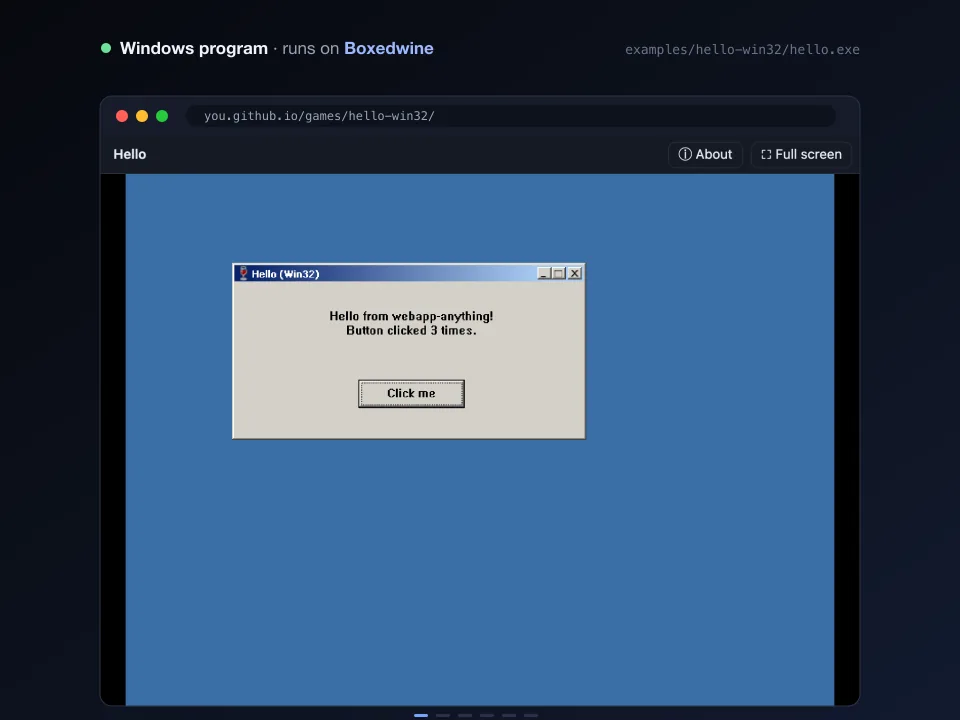
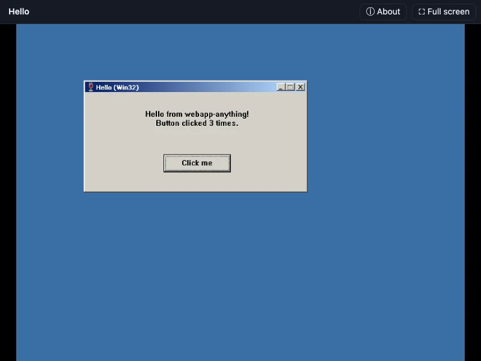
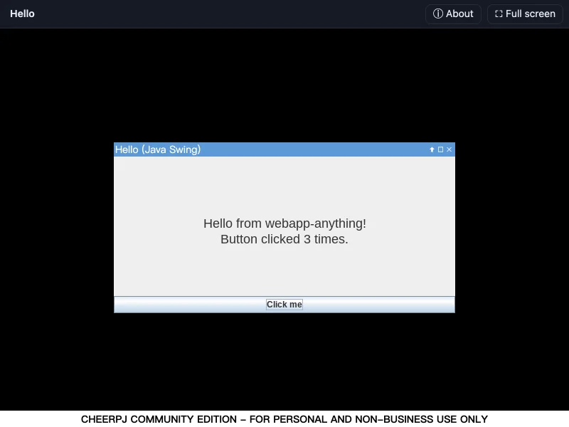
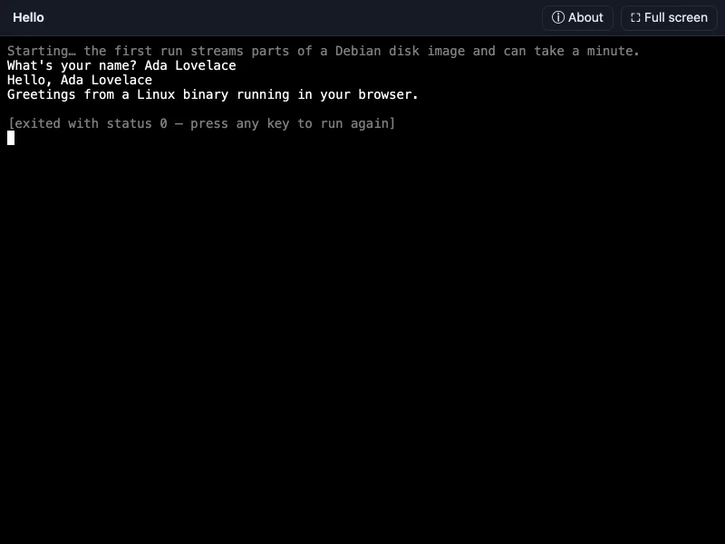
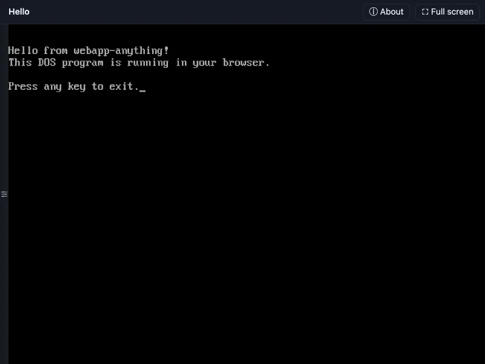
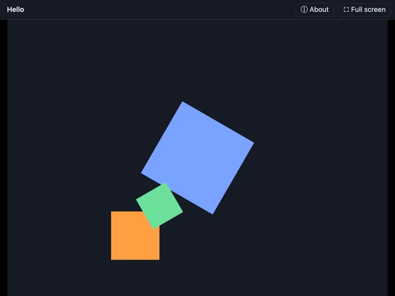
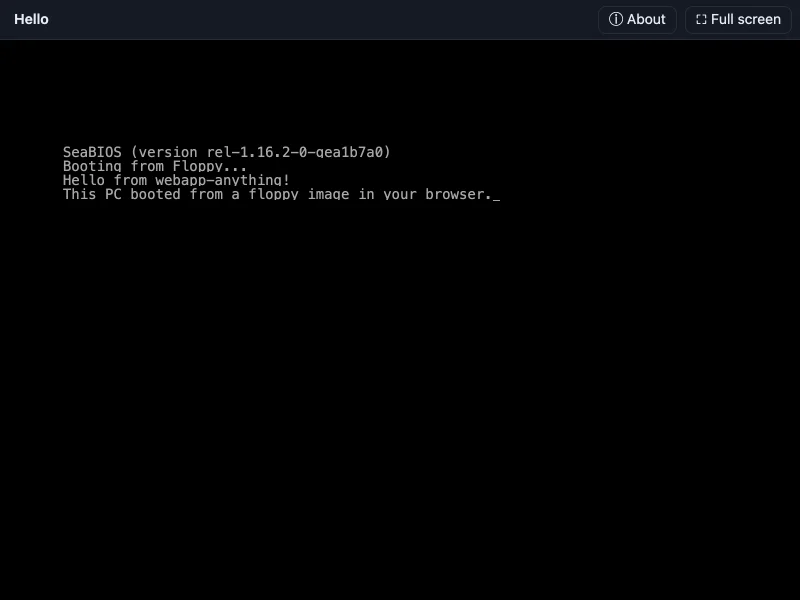

<div align="center"><a name="readme-top"></a>

<picture>
  <source media="(prefers-color-scheme: dark)" srcset=".github/assets/banner-dark.svg">
  
</picture>

### Turn desktop software into a web app you can publish with one command.

DOS and Windows programs · Java apps · Flash movies · Linux binaries · bootable disk images

**English** · [简体中文](README.zh-CN.md) · [Quick start](#-quick-start) · [What it runs](#-what-it-runs) · [Self-hosting](#-self-hosted-publishing-server) · [Docs](docs/architecture.md) · [Changelog](CHANGELOG.md)

[![][ci-shield]][ci-link]
[![][license-shield]][license-link]
[![][node-shield]][node-link]
[![][ts-shield]][ts-link]
[![][docker-shield]][docker-link]
[![][stars-shield]][stars-link]

<br>



</div>

<details>
<summary><kbd>Table of contents</kbd></summary>

- [✨ Why](#-why)
- [🎬 See it run](#-see-it-run)
- [🧩 What it runs](#-what-it-runs)
- [🚀 Quick start](#-quick-start)
- [⚙️ How it works](#️-how-it-works)
- [🛳 Self-hosted publishing server](#-self-hosted-publishing-server)
- [🔒 Security](#-security)
- [⚖️ Licensing](#️-licensing)
- [🗺 Roadmap](#-roadmap)
- [🛠 Development](#-development)

</details>

## ✨ Why

<table>
<tr>
<td width="33%" valign="top">

**🪄 No rewrite**

Give it the `.exe`, `.jar`, `.swf`, `.iso` or zip you already have. It reads the headers, finds the main program
and picks a browser runtime that can run it unchanged.

</td>
<td width="33%" valign="top">

**🌐 Runs in the browser**

Everything executes in the visitor's WebAssembly sandbox: DOSBox, Wine, Ruffle, a JVM, an x86 PC, a Linux
userland. Your server only serves static files.

</td>
<td width="33%" valign="top">

**🚀 Publish anywhere**

The output is a plain static site: offline-capable, installable as a PWA, with header rules for Netlify,
Cloudflare Pages and Vercel. Or push it to GitHub Pages or your own server.

</td>
</tr>
</table>

## 🎬 See it run

<div align="center">

<br>
<sub>Real screenshots of the samples in <a href="examples"><code>examples/</code></a>, built with <code>waa build</code> and running in Chrome.</sub>
</div>

<br>

<table>
<tr>
<td align="center" width="33%"><br><b>Windows</b> · Boxedwine<br><sub><code>hello.exe</code>: the button counts clicks</sub></td>
<td align="center" width="33%"><br><b>Java Swing</b> · CheerpJ<br><sub><code>hello.jar</code></sub></td>
<td align="center" width="33%"><br><b>Linux</b> · CheerpX<br><sub><code>hello</code>: reads input from the terminal</sub></td>
</tr>
<tr>
<td align="center"><br><b>DOS</b> · js-dos<br><sub><code>HELLO.COM</code></sub></td>
<td align="center"><br><b>Flash</b> · Ruffle<br><sub><code>hello.swf</code>: animated</sub></td>
<td align="center"><br><b>Floppy image</b> · v86<br><sub><code>hello.img</code>: boots through SeaBIOS</sub></td>
</tr>
</table>

<div align="right">

[![][back-to-top]](#readme-top)

</div>

## 🧩 What it runs

| Input | Runs on | Status |
| :-- | :-- | :-: |
| DOS `.exe`/`.com`/`.bat`, DOS/4GW games, zipped game folders, js-dos bundles | [js-dos](https://js-dos.com) (DOSBox → WebAssembly) | ![][stable] |
| 16- and 32-bit Windows `.exe` (GDI, DirectDraw) | [Boxedwine](https://github.com/danoon2/Boxedwine) (Wine on an emulated x86) | ![][experimental] |
| Flash `.swf` | [Ruffle](https://ruffle.rs) | ![][stable] |
| Java `.jar` (Swing/AWT, Java 8/11/17) | [CheerpJ](https://cheerpj.com) | ![][stable] |
| `.iso`, floppy and hard-disk `.img` | [v86](https://github.com/copy/v86) (x86 PC emulator) | ![][stable] |
| 32-bit x86 Linux binaries, shell/Python scripts | [CheerpX](https://cheerpx.io) + xterm.js | ![][experimental] |
| Folder or zip with `index.html` | published unchanged | ![][stable] |
| Electron `app.asar` / `resources/app` | renderer with stubbed Electron APIs | ![][experimental] |
| Any program plus your own installed Windows 9x/DOS disk image (`--guest`) | v86 or [DOSBox-X](https://dosbox-x.com), program on drive D: | ![][experimental] |
| 64-bit Windows, 64-bit/ARM Linux GUI apps | **stream**: a Docker project that runs it natively and streams it with [Selkies](https://github.com/selkies-project/selkies) | ![][experimental] |
| Android `.apk` | **stream**: an Android 14 emulator ([docker-android](https://github.com/budtmo/docker-android)) streamed over noVNC | ![][experimental] |
| Anything, rewritten as real web code | **`waa rebuild`**: a Claude agent reads the program, screenshots it running and writes a web version | ![][experimental] |
| iOS `.ipa`, macOS apps | not supported (the scanner explains why) | – |

Every runtime is pinned to an exact version and checked against a hash before use (see
[`src/runtimes/registry.ts`](src/runtimes/registry.ts)). The details and limits of each backend are in
[docs/backends.md](docs/backends.md).

> [!NOTE]
> The Windows backend boots Wine on an emulated CPU, so the first start takes 10–60 seconds. Programs that need
> OpenGL or Direct3D, 64-bit programs and .NET programs don't run in the browser build; use `--backend stream` for those,
> or `--guest win98.img --guest-engine dosboxX` for Windows 9x games that need DirectX or 3dfx.

<div align="right">

[![][back-to-top]](#readme-top)

</div>

## 🚀 Quick start

Node.js 22.12 or newer.

```bash
npx webapp-anything build game.zip                                  # → out/game/
npx webapp-anything preview out/game                                # → http://127.0.0.1:4173
npx webapp-anything publish out/game --to github-pages --repo you/games
```

Or install it globally for the short `waa` command (`npm install -g webapp-anything`). To work from source:

```bash
git clone https://github.com/Terse-AI/webapp-anything && cd webapp-anything
npm ci && npm run build && node dist/cli.js --help
```

<details>
<summary><b>1. Scan:</b> what is this file, and what can run it?</summary>

```console
$ waa scan hello.exe
Input    hello.exe (4.0 KB, file, 1 file)
Found    Windows program (32-bit x86, gui): hello.exe
Runs on  windows — Windows (Boxedwine) score 80, experimental
         32-bit Windows programs run under Wine in the browser.
Also     stream (30)
```

`--json` prints the full report: every program found and how it ranked, parsed headers (PE imports, ELF
interpreter and libraries, SWF size, JAR main class and Java version…), and warnings such as "this is an installer",
"needs Direct3D" or "needs the Universal C Runtime".

</details>

<details>
<summary><b>2. Build:</b> make a bundle</summary>

```bash
waa build keen.zip                         # out/keen/
waa build tools.zip --entry bin/tool.exe   # choose the program yourself
waa build movie.swf --title "Intro" --autostart
waa build app.exe --threads                # faster multi-threaded Boxedwine (needs COOP/COEP)
waa build big.zip --runtime cdn            # load runtimes from jsDelivr instead of copying them
```

```
out/keen/
├── index.html              player page: play button, loading, errors, full screen, About
├── app/app.jsdos           your program, packed for its runtime
├── runtime/js-dos@8.5.0/   the runtime, pinned and hash-checked, with its license
├── sw.js                   offline cache (and cross-origin isolation where needed)
├── manifest.webmanifest    installable as a PWA
├── _headers, vercel.json   header rules for Netlify, Cloudflare Pages and Vercel
└── waa.json                bundle manifest
```

</details>

<details>
<summary><b>3. Publish:</b> put it online</summary>

```bash
waa publish out/keen --to github-pages --repo you/games     # https://you.github.io/games/keen/
waa publish out/keen --to server --server https://apps.example.com --token $WAA_TOKEN
waa publish out/keen --to dir --dest /var/www/keen          # any static host
waa publish keen.zip --to server --server …                 # build and publish in one step
```

GitHub Pages can't send custom headers. Bundles that need cross-origin isolation (Linux programs, threaded
Boxedwine) get it from their service worker, which reloads the page once on the first visit.

</details>

<details>
<summary><b>4. Check:</b> record what the original does and replay it against any build</summary>

```bash
waa record out/keen -o keen.json                 # use the app in Chrome; F2 marks a snapshot
waa check out/keen -s keen.json --update         # save the screens as baselines
waa check out/keen -s keen.json                  # later: replay, diff, fail on changes (report.html)
waa compare out/keen rebuild/keen/bundle -s keen.json --min 0.8   # original vs rebuild
```

A scenario is JSON: `start`, `sleep`, `waitFor`, `click`, `move`, `type`, `key` and `snapshot` steps. Checks run in
headless Chrome (SwiftShader by default, `--gpu` for the GPU) and work in CI.

</details>

<details>
<summary><b>5. Saves:</b> keep progress and move it between devices</summary>

DOS programs (every file they change), Flash movies (their SharedObjects) and PC images (the whole machine state)
save automatically in the browser. The **Saves** button in the player downloads a `.waasave` file, loads one, or
turns on **sync**: apps published to a `waa serve` server get a sync code (`ABCDE-FGHIJ-KLMNO-PQRST`) that carries
the save to another browser or device. Enter the code there and the game continues where it was left.

</details>

<details>
<summary><b>6. Guest OS:</b> run programs inside your own Windows 98</summary>

```bash
waa build game.zip --guest win98.img                        # v86: streams the disk, saves the whole machine
waa build game.zip --guest win98.img --guest-engine dosboxX # DOSBox-X: Pentium MMX, S3, DirectX/3dfx-era games
```

The program's files become a CD-ROM (ISO 9660 + Joliet) that the guest sees as drive D:. You supply the
operating system image and its license; webapp-anything never ships one.

</details>

<details>
<summary><b>7. AI rebuild:</b> rewrite the program as a native web app</summary>

```bash
export ANTHROPIC_API_KEY=…
waa rebuild WINMINE.EXE                                    # → rebuild/winmine/{source,bundle}
waa rebuild game.exe --mcp "rea=npx -y rea-mcp" --notes "keep the original keyboard layout"
```

A Claude agent (`claude-opus-5-5` by default) lists the program's files, decodes its menus, dialogs and string
tables, reads strings and hex, runs the original in its emulator and screenshots it, writes HTML/CSS/JS, then
screenshots its own build next to the original and fixes the differences. `--mcp` hands it the tools of any
stdio MCP server, such as a reverse-engineering server like [REA](https://github.com/morluto/rea). Writes stay
inside the output folder. The run asks before it starts because the API usage is billed to your key; it uses
adaptive thinking, prompt caching and the API's server-side model fallback (`--no-fallbacks` turns that off).

</details>

<div align="right">

[![][back-to-top]](#readme-top)

</div>

## ⚙️ How it works

<picture>
  <source media="(prefers-color-scheme: dark)" srcset=".github/assets/pipeline-dark.svg">
  
</picture>

1. **Scan.** The input is opened as a file tree (single file, folder, zip or asar) without being unpacked. Parsers
   read only the headers they need: MZ/NE/LE/PE, ELF, Mach-O, SWF, ISO 9660/El Torito, MBR, JAR manifests, class
   files and Electron `package.json`. Inside archives every candidate program is ranked. Setup tools, DLLs and
   installers rank low; names that match the archive rank high.
2. **Plan.** Each backend scores the scan. The best one wins, and `--backend` overrides it.
3. **Build.** The backend packs the program the way its runtime expects (a `.jsdos` bundle with a generated
   `dosbox.conf`, a Wine `C:\files` zip, a tarball for the Linux userland…) and writes a page around the shared player.
4. **Publish.** Bundles are plain static sites with a manifest, so any host works.

More in [docs/architecture.md](docs/architecture.md).

<div align="right">

[![][back-to-top]](#readme-top)

</div>

## 🛳 Self-hosted publishing server

`waa serve` adds a drag-and-drop upload page, an HTTP API and app hosting. Drop a file on the page, check what
was detected, pick a runtime and get a link back.

```bash
docker compose up -d                        # data lives in the waa-data volume
# or
waa serve --port 8080 --data ./waa-data     # prints the publish token on first start
```

Files are stored by content hash, so a 40 MB Wine runtime shared by a hundred Windows apps is stored once. The
server sends the right `Content-Type`, `ETag`, `Range` and COOP/COEP headers for each app, and can give every app
its own origin.

<details>
<summary><b>Options</b></summary>

| Option | Env | Default | |
| :-- | :-- | :-- | :-- |
| `--port` | `PORT` | `8080` | |
| `--host` | `HOST` | `127.0.0.1` | `0.0.0.0` in Docker |
| `--data` | `WAA_DATA_DIR` | `./waa-data` | apps, blobs, token, runtime cache |
| `--token` | `WAA_TOKEN` | generated | needed to upload, list and delete |
| `--public-url` | `WAA_PUBLIC_URL` | from the `Host` header | base URL used in links |
| `--app-origin` | `WAA_APP_ORIGIN` | same origin | e.g. `https://{slug}.apps.example.com` (recommended, see [Security](#-security)) |
| `--max-upload` | `WAA_MAX_UPLOAD_MB` | `1024` | MB |
| `--open-uploads` | `WAA_OPEN_UPLOADS=1` | off | anyone may upload (rate-limited); each app gets its own delete key |
| | `WAA_TRUST_PROXY=1` | off | trust `X-Forwarded-*` from your reverse proxy |

</details>

<details>
<summary><b>HTTP API</b></summary>

```bash
# One shot: upload, build and publish
curl -H "Authorization: Bearer $WAA_TOKEN" --data-binary @game.zip \
  "https://apps.example.com/api/apps?filename=game.zip&title=My%20Game"

# Two steps, as the web page does: scan first, then publish with your choices
curl -H "Authorization: Bearer $WAA_TOKEN" --data-binary @game.zip "…/api/uploads?filename=game.zip"
curl -H "Authorization: Bearer $WAA_TOKEN" -H "Content-Type: application/json" \
  -d '{"upload":"<id>","backend":"dos","slug":"game"}' …/api/apps
```

Also `PUT /api/apps/:slug` (upload a built bundle as a zip; this is what `waa publish --to server` does),
`GET /api/apps`, `GET /api/apps/:slug`, `DELETE /api/apps/:slug`, `GET /api/info` and `GET /healthz`.

</details>

<div align="right">

[![][back-to-top]](#readme-top)

</div>

## 🔒 Security

- Programs run inside the browser's WebAssembly sandbox, not on your server. The exception is `stream`, which runs
  the program in a container you start yourself.
- Uploaded apps are arbitrary web content. If you host other people's uploads, use
  `--app-origin https://{slug}.apps.example.com`, so apps can't reach the server's API or each other's storage.
- Archives are unpacked with path-traversal checks, entry-count and size limits, and CRC verification.
- Runtimes are pinned and hash-verified before they are cached or copied into a bundle.

See [SECURITY.md](SECURITY.md) to report a vulnerability.

## ⚖️ Licensing

webapp-anything is MIT-licensed. The runtimes keep their own licenses, which are copied into every bundle:
js-dos and Boxedwine are GPL-2.0, Ruffle is MIT/Apache-2.0, v86 is BSD-2-Clause (SeaBIOS is LGPL-3.0), and
xterm.js is MIT. CheerpJ and CheerpX are proprietary and load from Leaning Technologies' CDN. They are free for
personal and open-source use; commercial use needs a license from Leaning Technologies.

> [!IMPORTANT]
> Only publish software you have the right to distribute. Converting a program doesn't change its license.

<div align="right">

[![][back-to-top]](#readme-top)

</div>

## 🗺 Roadmap

- [x] Scanner for DOS, Windows, Linux, macOS, Java, Flash, disk images, Electron, web, Android and iOS inputs
- [x] Ten backends, pinned runtimes, offline PWA bundles
- [x] Publishing to a self-hosted server, GitHub Pages or any static host
- [x] **AI rebuild:** `waa rebuild` explores a program with an agent (optionally through MCP tools such as
      [REA](https://github.com/morluto/rea)'s) and writes a real web reimplementation
- [x] Behaviour checks: record input and screens in the original and replay them against the web build
- [x] Android through a streamed emulator; Windows 9x guests through v86 or DOSBox-X images
- [x] Saved-game sync between devices (DOS, Flash, PC images)
- [ ] Saves for Windows, Java and Linux programs
- [ ] Android streaming over WebRTC (lower latency than noVNC)
- [ ] `waa rebuild` from a `waa record` scenario, so the agent replays the same moments it is compared on

## 🛠 Development

```bash
npm ci
npm run build          # TypeScript → dist/
npm test               # unit and integration tests, no network
npm run test:runtimes  # downloads every pinned runtime and checks its hash
npm run lint
```

The README graphics are generated: see [scripts/readme](scripts/readme). Contributions are welcome, and
compatibility reports (what ran and what didn't) help the most. See [CONTRIBUTING.md](CONTRIBUTING.md).

<div align="center">

<br>

<sub>MIT © Terse AI · Built on the shoulders of js-dos, Boxedwine, Wine, Ruffle, v86, CheerpJ, CheerpX and xterm.js</sub>

</div>

<!-- LINK GROUP -->

[back-to-top]: https://img.shields.io/badge/-BACK_TO_TOP-151515?style=flat-square
[ci-link]: https://github.com/Terse-AI/webapp-anything/actions/workflows/ci.yml
[ci-shield]: https://img.shields.io/github/actions/workflow/status/Terse-AI/webapp-anything/ci.yml?branch=main&label=CI&labelColor=black&logo=githubactions&logoColor=white&style=flat-square
[docker-link]: compose.yaml
[docker-shield]: https://img.shields.io/badge/docker-compose_ready-2496ed?labelColor=black&logo=docker&logoColor=white&style=flat-square
[experimental]: https://img.shields.io/badge/experimental-d29922?style=flat-square
[license-link]: LICENSE
[license-shield]: https://img.shields.io/badge/license-MIT-7aa2ff?labelColor=black&style=flat-square
[node-link]: https://nodejs.org
[node-shield]: https://img.shields.io/badge/node-%E2%89%A522.12-6ce09a?labelColor=black&logo=nodedotjs&logoColor=white&style=flat-square
[stable]: https://img.shields.io/badge/stable-2ea043?style=flat-square
[stars-link]: https://github.com/Terse-AI/webapp-anything/stargazers
[stars-shield]: https://img.shields.io/github/stars/Terse-AI/webapp-anything?labelColor=black&logo=github&color=f0a35e&style=flat-square
[ts-link]: tsconfig.json
[ts-shield]: https://img.shields.io/badge/TypeScript-strict-3178c6?labelColor=black&logo=typescript&logoColor=white&style=flat-square
